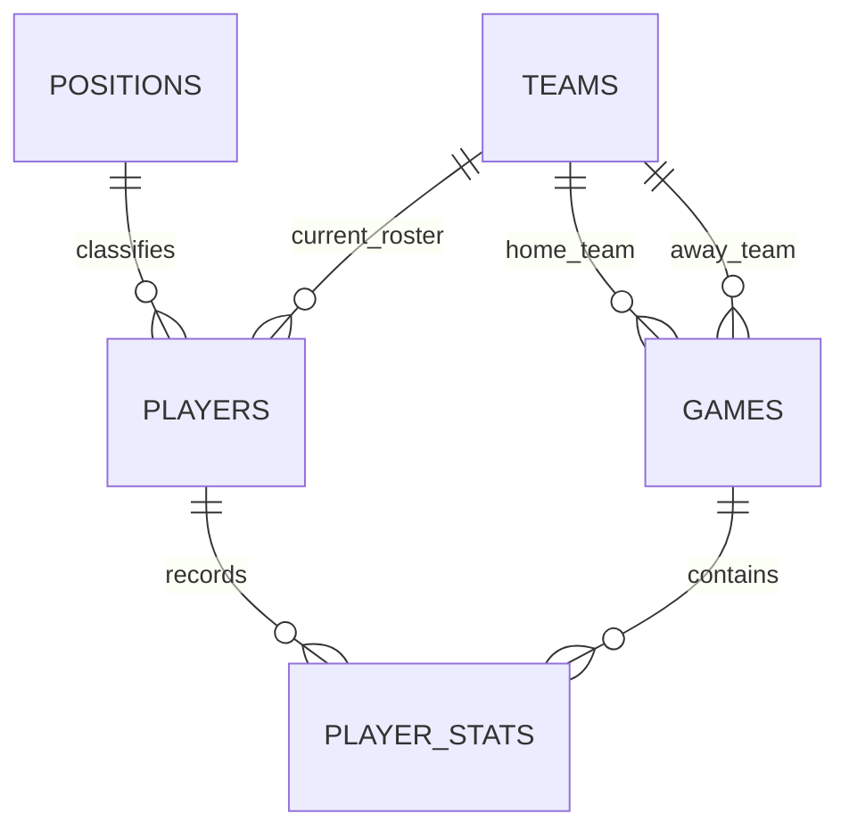

# NBA Oracle Relational Model

Model basketball rosters, games and player performance in **Oracle SQL**, then
answer roster, scoring and team-comparison questions with relational joins,
aggregate views and analytic ranking. The repository pairs the original final
coursework DDL with a compact demonstration using fictional records.

[Original final DDL](coursework/final_schema.sql) · [Demonstration schema](schema.sql) · [Analytical SQL](analysis_queries.sql) · [Methods and limits](METHODS_AND_LIMITATIONS.md)

**Scope:** academic database design and SQL source. The original dates to 2024;
the public demonstration was reconstructed in 2026. Static checks are available;
a fresh Oracle runtime verification is still pending.

## Demonstration schema



`player_stats` has one row per `game_id + player_id`. Home and away teams must
differ; checks reject negative box-score values. Fixture sizes are five
positions, four teams, eight players, four games and eight player-stat rows.
Only two games contain sample player lines; these are partial demonstrations,
not reconciled complete box scores.


The [execution checklist and expected-result contract](verification/README.md)
now provide a single `@verify.sql` entry point for a future disposable-schema
run. It checks fictional fixture totals and rollback-safe negative constraints.
The runner is **not Oracle runtime evidence**; execution in Oracle remains
`Needs Evidence`.

## Skills demonstrated

| Skill | Inspect the evidence |
| --- | --- |
| **Oracle SQL, relational data modeling, entity relationships** | Five demonstration entities, explicit game/player grain and home/away relationships in [schema.sql](schema.sql) |
| **Data integrity, primary/foreign keys, unique and check constraints** | Roster uniqueness, distinct game teams and nonnegative statistics in [schema.sql](schema.sql) |
| **SQL joins, GROUP BY, aggregate functions and reusable views** | Player/team summaries and game-level joins in [analysis_queries.sql](analysis_queries.sql) |
| **Window functions and deterministic ranking** | `ROW_NUMBER() OVER (PARTITION BY … ORDER BY …)` with a player-ID tie-breaker in [analysis_queries.sql](analysis_queries.sql) |
| **Indexes and PL/SQL audit-trigger source** | Access-path definitions in the demo; a sequence and update-audit trigger in the [original final DDL](coursework/final_schema.sql), with runtime limits documented separately |
| **Python unittest and static validation** | [Package checks](tests/test_sql_package.py) inspect SQL structure, links and publication boundaries without executing Oracle |

**Author:** Vansh Verma. The original database work dates to 2024; the public
reconstruction and source reconciliation are from 2026. This is an academic
portfolio project, with no league affiliation or production deployment claimed.

## Two clearly separated versions

| Version | Purpose | Contents |
| --- | --- | --- |
| [Original final DDL](coursework/final_schema.sql) | Historical source evidence | Seven business tables plus an audit-log table, ten foreign keys, three views, three explicit indexes, a sequence and an update-audit trigger |
| [Public demonstration](schema.sql) | Compact, fictional-data example | A five-table Oracle relational model, primary/foreign/check/unique constraints, seven indexes, joins, grouped summaries, a view and deterministic analytic ranking |

The original DDL was recovered from the author's final-project folder on
November 8, 2026. It is preserved separately, including its design limitations;
see [coursework notes](coursework/README.md). The demonstration is a redesigned,
sanitized reconstruction of individually authored coursework, **not a verbatim
copy or a claim that the original had the same table grains**.

## Business questions in the demonstration

- Which players belong to each team and position?
- What player lines were recorded for each game?
- What are each player's total points, assists, rebounds and turnovers?
- How do players rank within their current team by recorded points?
- What team totals follow from the supplied player lines?


All demonstration records are fictional sample data. No real roster, game log,
salary data, private report, presentation, personal identifier or screenshot is
published.

## Files

- [schema.sql](schema.sql): demonstration DDL, constraints and indexes
- [sample_data.sql](sample_data.sql): original fictional demonstration records
- [analysis_queries.sql](analysis_queries.sql): joins, aggregation, view and ranking
- [coursework/final_schema.sql](coursework/final_schema.sql): unchanged original DDL
- [coursework/README.md](coursework/README.md): provenance and original-design caveats
- [METHODS_AND_LIMITATIONS.md](METHODS_AND_LIMITATIONS.md): evidence and design limits
- [DATA_AND_USAGE.md](DATA_AND_USAGE.md): ownership and data boundary
- [verify.sql](verify.sql): error-stopping entry point for an empty Oracle schema
- [verification/README.md](verification/README.md): runtime checklist and hand-calculated expectations
- [tests/test_sql_package.py](tests/test_sql_package.py): dependency-free static package checks

## Run the static checks

From the repository root, using Python 3:

```sh
PYTHONDONTWRITEBYTECODE=1 python3 -m unittest discover -s tests -p 'test_*.py' -v
```

These inspect source structure, relative links, privacy patterns and claim
boundaries. They do not execute SQL or establish database compatibility.

## Suggested Oracle demonstration run

In an **empty, disposable Oracle schema**, run only:

```sql
@verify.sql
```

This runner loads schema, fixture and queries, then asserts expected outputs and
constraint failures. The demonstration targets Oracle 21c. Do not combine it with the historical
DDL: overlapping object names represent different schemas.

## Verification status

Source files and static package checks are available for inspection. Successful
execution in Oracle remains `Needs Evidence` for this exact reconstruction.
Earlier private assignment evidence is separate; neither it nor the recovered
final source establishes a fresh, clean-schema run of this repository.

The recovered final DDL contains executable trigger source; no successful
compilation, trigger firing, performance benchmark or production use is claimed.
See [limitations](METHODS_AND_LIMITATIONS.md) before reusing the schema.

## License

The author's SQL, documentation, tests and fictional sample records are supplied
under the [MIT license](LICENSE). No third-party sports data is distributed.
